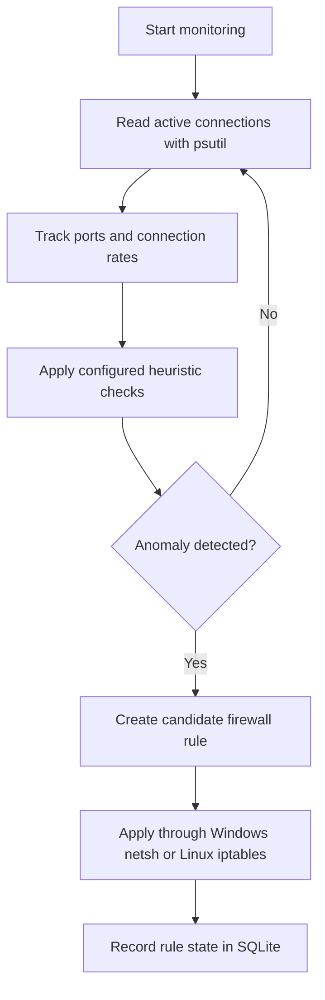

# Dynamic Firewall Rule Generator

A Python desktop application that monitors active network connections, flags heuristic anomalies, and can create firewall rules through operating-system firewall commands.

> **Status:** Experimental security project. Detection is heuristic, not a validated intrusion-detection system. Run it only on systems and networks you own or are explicitly authorised to administer. Test rule changes in a disposable lab or virtual machine before using them on a host you depend on.

## What it does

The application combines a Tkinter interface, connection monitoring with `psutil`, configurable anomaly thresholds, SQLite persistence, and firewall rule management.

### Implemented components

- **Connection monitoring:** Reads active Internet connections and associated process information through `psutil`.
- **Heuristic anomaly checks:** Tracks remote ports and connection rates, then flags patterns such as repeated port access and unusually high connection counts.
- **Desktop interface:** Provides a Tkinter GUI for interacting with monitoring and rule-management workflows.
- **Firewall integration:** Uses Windows `netsh advfirewall` commands on Windows and `iptables` on Linux.
- **Persistence:** Stores generated firewall rules and related state in SQLite.
- **Configuration:** Reads thresholds and application options from `config.json`.

The current detection logic uses simple thresholds and connection metadata. It does not establish that a host is malicious, inspect encrypted application payloads, or provide machine-learning-based threat classification.

## How the workflow fits together



## Technology

- Python 3
- Tkinter
- psutil
- SQLite
- JSON configuration
- Windows Firewall command-line tooling (`netsh`)
- Linux `iptables`

Most imports used by the main application are from the Python standard library. The third-party runtime dependency visible in `gui.py` is `psutil`.

## Requirements

- Python 3.10 or newer
- `psutil`
- Tkinter support for your Python installation
- Windows with Windows Defender Firewall tooling, or Linux with `iptables`
- Administrative privileges when applying firewall changes

On Debian/Ubuntu/Parrot OS, install the GUI and Python package support:

```bash
sudo apt update
sudo apt install python3-tk python3-venv iptables
```

## Run locally

Clone the repository:

```bash
git clone https://github.com/Kavyanjali07/Dynamic-Firewall-Rule-Generator.git
cd Dynamic-Firewall-Rule-Generator
```

Create and activate a virtual environment:

```bash
python3 -m venv .venv
source .venv/bin/activate
python -m pip install --upgrade pip
python -m pip install psutil
```

Start the application:

```bash
python gui.py
```

The application may request elevated privileges when it applies firewall rules. Review the command and target before approving any privileged operation.

## Configuration

The checked-in `config.json` currently contains:

| Setting | Purpose | Current value |
|---|---|---:|
| `scan_interval` | Monitoring interval in seconds | `5` |
| `port_scan_threshold` | Port-count threshold used by the detector | `10` |
| `auto_block_enabled` | Enables automatic blocking behaviour | `true` |
| `log_level` | Logging verbosity | `INFO` |
| `database_path` | SQLite database path | `network_security.db` |
| `max_log_entries` | Log-entry retention limit | `10000` |
| `alert_retention_days` | Alert retention period | `30` |

**Safety recommendation:** Set `auto_block_enabled` to `false` while learning the application or validating detection behaviour. Review every proposed rule before enabling automatic blocking.

## Important security considerations

- Incorrect blocking decisions can interrupt SSH, remote administration, DNS, or other essential connectivity.
- A high connection count or many accessed ports is only a heuristic signal; it is not proof of an attack.
- Test in a VM or isolated lab and keep console access available before applying rules.
- Review generated rules and the rule-removal path before relying on automatic expiry.
- Use least privilege. Do not run the entire desktop application as root unless the implementation genuinely requires it.
- The current implementation should be treated as a learning prototype, not as a replacement for a managed firewall or production network-security platform.

## Known limitations and engineering work

The project would benefit from additional validation before production use:

- Unit tests for anomaly thresholds and firewall command construction
- Safer privilege separation for firewall operations
- Explicit rule ownership and unique rule identifiers for reliable removal
- IPv6 handling and protocol/port validation
- Dry-run mode and a visible approval step before applying rules
- Structured audit logs and clearer failure reporting
- Cross-platform integration tests
- Documentation of supported firewall versions and permissions

## Author

**Kavyanjali**

- [GitHub](https://github.com/Kavyanjali07)
- [LinkedIn](https://www.linkedin.com/in/kavyanjali07)
